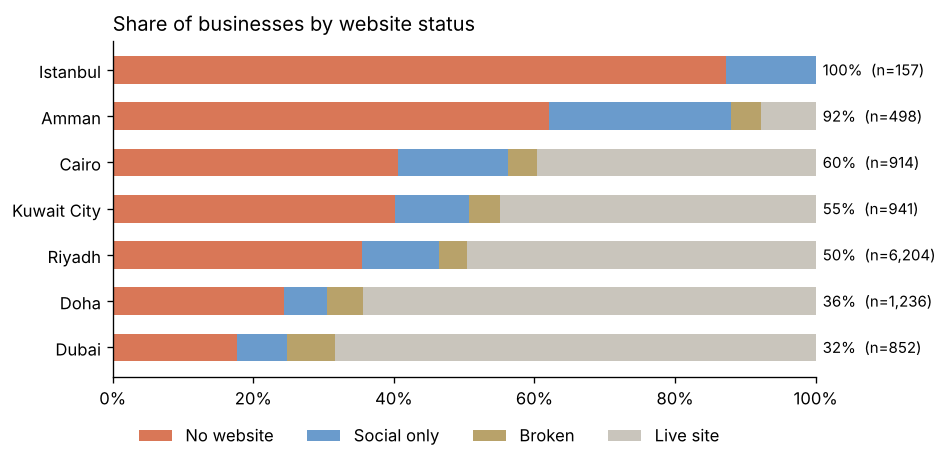
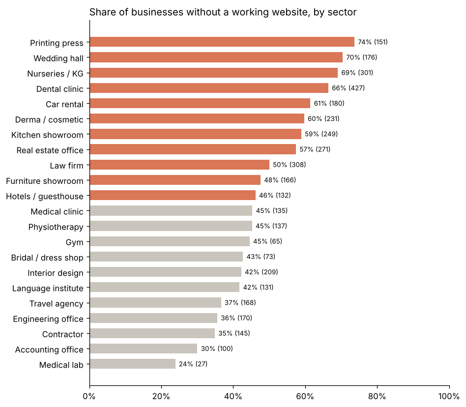
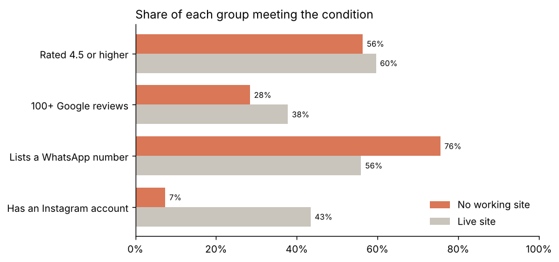

# MENA Web Presence Gap

Data analysis of **10,802 local businesses** across seven MENA cities, answering three questions:

1. How many businesses have no working website?
2. Where (city, sector) is the gap largest?
3. Are offline businesses weaker businesses, or good businesses that are simply offline?

The data comes from Google Maps listings I collected for a website-building outreach project. Each listing's website was checked and labelled `live`, `broken`, `social_only` or `none`. Only aggregated counts are published, with no business names or contact details.

## Key findings

| | |
|---|---|
| Businesses analysed | **10,802** |
| Without a working website | **5,524 (51%)** |
| No website at all | **3,851 (36%)** |
| Priority prospects (no site, 4.5+ stars, 100+ reviews, WhatsApp) | **304** |

**1. The gap varies a lot by city.** 92% of listed businesses in Amman have no working website, against about one third in Dubai (32%) and Doha (36%). Istanbul is left out of this comparison because its listings came from a search for businesses without a website.



**2. Printing presses, wedding halls and nurseries need websites most.** Medical labs and accounting offices are the most online.



**3. Offline does not mean low quality, but it does mean less visible.** Ratings are close: 56% vs 60% at 4.5+ stars, a real but small gap of 3.3 points (95% CI 1.4 to 5.1). Reviews differ more: 28% vs 38% have 100+ reviews. Offline businesses rely on WhatsApp instead (76% vs 56%) and rarely have Instagram (7% vs 43%).



## What's in the repo

```
app.py              # interactive Streamlit app
analysis.ipynb      # full analysis with code, charts and findings
build_notebook.py   # regenerates the notebook from source
data/               # aggregated CSVs (by city, sector, quality signal)
images/             # charts exported from the notebook
```

## Run it

```bash
pip install -r requirements.txt
streamlit run app.py              # interactive app
jupyter notebook analysis.ipynb   # full analysis with code
```

The app reads the same CSVs as the notebook, so the two always agree. It adds a toggle to bring Istanbul back into the city comparison, a slider to filter sectors by sample size, and the confidence interval on every quality gap.

## Method and limitations

- "Without a working website" = no website + social-media only + broken site.
- Listings come from targeted Google Maps searches, not a random sample of every business in each city.
- Riyadh is 57% of rows, so cities are compared by share, not count.
- Istanbul's 157 listings came from a lead search for businesses without a website, so 0 live sites there is how they were collected, not a finding. They count in the totals but are excluded from the city comparison.
- Cities may differ in sector mix, which can drive part of the city gap.
- Sector results cover the 22 largest sectors (7,886 listings, 73% of the total).
- Website status reflects the time of collection (October 2026).
- Gaps between businesses with and without a site are reported with 95% confidence intervals in the notebook (two-proportion, normal approximation).

**Tools:** Python, pandas, matplotlib, Jupyter, Streamlit, Altair.

## Author

Khaled Noaman · [LinkedIn](https://linkedin.com/in/khalednoaman1) · [GitHub](https://github.com/KHALEDNOAMAN)
